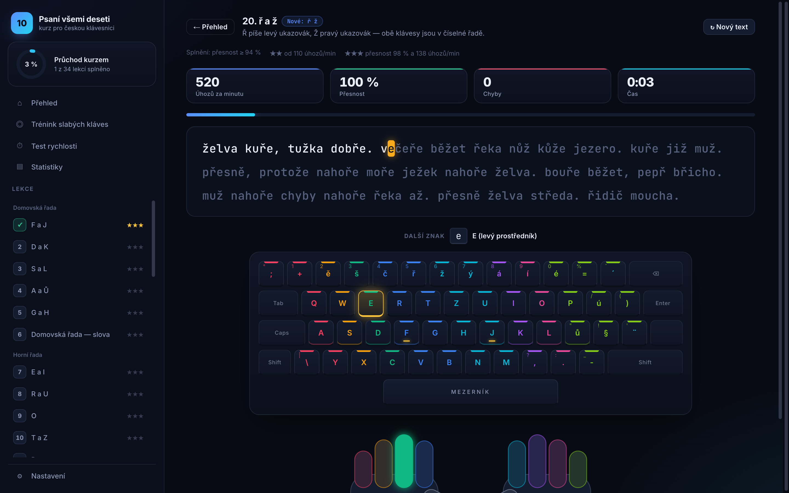

<div align="center">

# ⌨️ Psaní všemi deseti

**Bezplatný interaktivní kurz psaní všemi deseti na české klávesnici.**
Od prvních dvou kláves po plynulý text s diakritikou — přímo v prohlížeči, bez registrace.

### [▶ Vyzkoušet na psani.hilgard.cz](https://psani.hilgard.cz)



</div>

---

## ✨ Co kurz umí

### 🎯 Učí správně — na skutečné české klávesnici
- **Věrné rozložení ČSN (QWERTZ i QWERTY).** Diakritika v horní řadě, číslice se Shiftem, `ů` na domovské řadě, Z vpravo nahoře.
- **Mrtvé klávesy.** `ď`, `ť`, `ň`, `ó` a velká `Č`, `Ř`, `Á`… se píšou dvěma úhozy — nápověda ukáže oba kroky.
- **Správné prsty.** Každá klávesa má svůj prst podle české metodiky, Shift se mačká malíkem opačné ruky.

### 📚 34 lekcí podle četnosti písmen v češtině

| Část | Co se naučíte |
|---|---|
| **Domovská řada** | F J → D K → S L → A Ů → G H → první slova |
| **Horní řada** | E I, R U, O, T Z, P |
| **Dolní řada** | N M, V B, C Y, čárka a tečka, X W Q |
| **Diakritika** | ě š č ř ž ý á í é ú a mrtvé klávesy pro ď ť ň ó |
| **Shift, číslice a znaménka** | velká písmena, `? ! : - ( )`, číslice, `+ = % / " ;` |
| **Souvislý text** | skutečné odstavce a závěrečná zkouška |

- **Každý pokus je jiný text.** Cvičení se generuje ze slovníku ~900 českých slov — vždy **jen z písmen, která už znáte**, s důrazem na nové klávesy.
- **Zvládnutí, ne jen dokončení.** Lekci splníte s přesností alespoň 94 %, rychlost přináší další ⭐.

### 🧠 Přizpůsobí se vám
- **Trénink slabých kláves** — sleduje přesnost a prodlevu každého znaku a skládá text z toho, co vám nejde.
- **Postupné odvykání koukání** — u nových kláves celá klávesnice, při opakování jen ruce, u souvislého textu nic. Po chybě se nápověda vždy vrátí.
- **Test rychlosti** na 1, 3 nebo 5 minut v **úhozech za minutu** podle české normy (Shift i mrtvá klávesa jsou úhoz navíc).

### 📊 Vidíte svůj pokrok
- Graf rychlosti a přesnosti, **teplotní mapa chyb** na klávesnici, nejslabší znaky, historie cvičení.
- Denní cíl a série dní v řadě.
- Rozbor chyb podle prstů po každém cvičení.

### 🎨 Příjemné na používání
- Tmavý i světlý vzhled, tři velikosti písma, text se posouvá po řádcích.
- Upozorní na zapnutý Caps Lock nebo anglickou klávesnici; v Chrome a Edge pozná rozložení systému sám.
- Přesný (opravujete hned) nebo volný režim (s Backspace).
- Záloha pokroku do souboru a přenos na jiný počítač.

## 🔒 Soukromí

Žádný účet, žádné cookies, žádná analytika. Pokrok se ukládá **jen ve vašem prohlížeči** (`localStorage`).
Fonty jsou hostované přímo na webu, takže se nikam neposílá ani vaše IP adresa.

## 🛠️ Technika

Čistý statický web — **HTML, CSS a JavaScript (ES moduly) bez frameworku a bez jediné závislosti.**

```
public/
├── index.html          # struktura stránky (bez inline skriptů a stylů → přísné CSP)
├── css/app.css         # vzhled, tmavý/světlý režim, responzivita
├── js/
│   ├── layout.js       # česká klávesnice, prsty, mrtvé klávesy, počítání úhozů
│   ├── curriculum.js   # osnova 34 lekcí a generátor cvičení
│   ├── words.js        # slovník, vlastní jména a souvislé texty
│   ├── store.js        # pokrok, statistiky kláves, validace importu
│   ├── keyboard.js     # klávesnice, ruce, teplotní mapa, grafy (DOM + SVG)
│   └── app.js          # aplikace: cvičení, výsledky, statistiky, nastavení
└── fonts/              # Inter a JetBrains Mono (licence OFL)
tests/check.test.js     # kontroly rozložení, prstů, osnovy a bezpečnosti importu
deploy/deploy.sh        # nasazení na server s nginx
```

### Spuštění lokálně

Stačí jakýkoli statický server (ES moduly nefungují z `file://`):

```bash
npx serve public
# nebo
python3 -m http.server -d public 8000
```

### Testy

```bash
npm test
```

Testy (vestavěný `node:test`, Node 20+) hlídají mimo jiné, že:
- rozložení odpovídá české normě a každý znak jde napsat,
- **žádná lekce nepoužije písmeno, které jste se ještě nenaučili** (ověřeno na stovkách generovaných textů),
- nové klávesy lekce se v textu opravdu procvičují,
- import zálohy odolá podvrženým datům (`__proto__`, špatné typy a rozsahy),
- `index.html` neobsahuje inline skripty ani styly, které by porušily CSP.

### Nasazení

Web běží na nginx s Let's Encrypt certifikátem a přísnou Content Security Policy
(`script-src 'self'; style-src 'self'`, žádné cizí domény).
Skript [`deploy/deploy.sh`](deploy/deploy.sh) zkontroluje DNS, atomicky vymění obsah webu,
při prvním spuštění vydá certifikát a nastaví vhost s bezpečnostními hlavičkami.

```bash
scp -r public deploy/deploy.sh server:/home/hilgard/deploy-psani/
ssh root@server 'bash /home/hilgard/deploy-psani/deploy.sh'
```

## 🙏 Poděkování

- Písma [Inter](https://rsms.me/inter/) a [JetBrains Mono](https://www.jetbrains.com/lp/mono/) pod licencí SIL Open Font License.

---

<div align="center">
<sub>Přesnost má přednost. Rychlost přijde sama. 🐢 → 🐇</sub>
</div>
